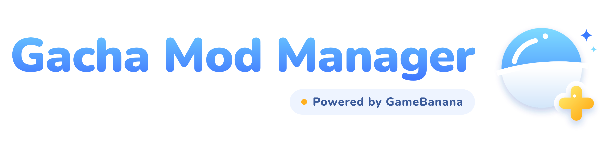

<picture>
  <source media="(prefers-color-scheme: dark)" srcset="docs/brand/gmm-lockup-dark.png">
  
</picture>

# Gacha Mod Manager

A desktop app for finding, downloading and organizing GameBanana mods for gacha games, using
[XXMI](https://github.com/SpectrumQT/XXMI-Launcher) as the mod loader.

**Status:** early development. The backend is complete and works from the `gmm` command
line: browse GameBanana, check your setup (`gmm status`), install mods into XXMI's Mods folder
with a safety scan (`gmm install`), switch them on and off, uninstall them to the Recycle Bin,
spot conflicts, show disk use, and start a game with mods through XXMI (`gmm launch`). Zip,
7z and RAR mods are supported. The app
window has the designed sidebar shell with the startup check, the Dashboard (Launch), the
Mods Library (with profiles), Downloads (the install queue) and the install confirmation.
Power features have started: update and roll back, profiles, key bindings, adopting
hand-installed mods, and installing from a local archive. The Mods Store and the remaining
screens come next.
Progress and plans: [docs/README.md](docs/README.md).

First games: Zenless Zone Zero and Wuthering Waves.

## Try it (developers)

Needs Rust (see `rust-toolchain.toml`) on Windows.

```bash
cargo run -p gmm-cli -- status
```

```bash
cargo run -p gmm-cli -- catalog list --game zzz --sort downloads
```

RAR mods go through a separate helper program; build it once next to `gmm` (the app's
`tauri dev` and `tauri build` do this themselves):

```bash
cargo build -p gmm-extract
```

The app window needs Node 24 too (pnpm comes through corepack):

```bash
cd apps/desktop && corepack pnpm install && corepack pnpm tauri dev
```

## Mods load through XXMI

This app downloads and manages mods. It doesn't load them. Mods only take effect when the game is
started through XXMI. Install XXMI from its
[official releases](https://github.com/SpectrumQT/XXMI-Launcher/releases) and set it up for your
game. The app detects your setup and walks you through any missing steps.

## Credits

Gacha Mod Manager is an open-source interface built on other people's work:

- **[GameBanana](https://gamebanana.com)**: the mod catalogue, its public API and the file
  hosting every mod comes from. GMM links back to each mod's page and never re-hosts files.
- **Mod creators**: every mod belongs to its author on GameBanana. GMM shows their names,
  credits and licenses as GameBanana lists them.
- **[XXMI Launcher](https://github.com/SpectrumQT/XXMI-Launcher)** by SpectrumQT, with its
  importers (ZZMI, WWMI and others): the mod loader. GMM detects it, reads a few of its settings
  and starts it; it never bundles or modifies it.
- **[3Dmigoto](https://github.com/bo3b/3Dmigoto)**, which XXMI builds on: GMM reads its `.ini`
  format to find conflicts and key bindings.
- **[UnRAR](https://www.rarlab.com/rar_add.htm)** by Alexander Roshal (RARLAB): opens RAR mods,
  under its own freeware license (see [THIRD-PARTY-NOTICES.md](THIRD-PARTY-NOTICES.md)).
- **[Nunito](https://github.com/googlefonts/nunito)** by the Nunito Project Authors: the
  interface font (SIL Open Font License 1.1).
- **Open-source libraries**, among them [Tauri](https://tauri.app), [React](https://react.dev),
  [DOMPurify](https://github.com/cure53/DOMPurify), [SQLx](https://github.com/launchbadge/sqlx),
  [reqwest](https://github.com/seanmonstar/reqwest), [rustls](https://github.com/rustls/rustls),
  [zip](https://github.com/zip-rs/zip2) and [sevenz-rust2](https://github.com/hasenbanck/sevenz-rust).
  The full list with licenses comes with each release.

If you are the original owner of credited work or assets and would like the credit adjusted
or the assets removed from the project, please contact me through
[GitHub](https://github.com/clorece/gacha-mod-manager/issues).

## License

Licensed under either of

- Apache License, Version 2.0 ([LICENSE-APACHE](LICENSE-APACHE))
- MIT license ([LICENSE-MIT](LICENSE-MIT))

at your option.

Unless you explicitly state otherwise, any contribution intentionally submitted for inclusion in
this project by you, as defined in the Apache-2.0 license, shall be dual licensed as above,
without any additional terms or conditions.

## Disclaimer

Not affiliated with or endorsed by HoYoverse, Kuro Games, GameBanana or the XXMI project. All
trademarks belong to their respective owners. Modding may violate a game's Terms of Service. Use
at your own risk.
