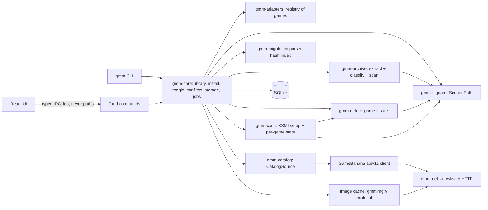

# 02 — Architecture

## Stack

| Layer | Choice | Why |
|---|---|---|
| Shell | Tauri 2 | Small native app; WebView2 on Windows, WebKitGTK on Linux; capability-based IPC; NSIS/MSI installers |
| Core logic | Rust workspace | All file, archive, network and process work lives here |
| UI | React + TypeScript + Vite, Tailwind + shadcn/ui, TanStack Query/Virtual, Zustand, Embla (carousel) | Widely used, well documented |
| Local DB | SQLite via `sqlx`, migrations in repo | One file in the app data dir |
| Archives | `zip`, `sevenz-rust2`, `unrar` (feature-gated), wrapped by our `gmm-archive` crate | All extraction goes through one hardened path |
| HTTP | `reqwest` (rustls), wrapped by our `gmm-net` crate | One place to enforce the host allowlist |
| Recycle Bin | `trash` crate | Deletes are recoverable |
| Tooling | pnpm, cargo workspace, `just` task runner | |

The **`gmm` CLI** is built from the same core crates. Every backend feature ships in the CLI first
(Phases 1–2). The UI (Phase 3) only presents what the CLI can already do.

## What GMM does and doesn't do

| GMM does | GMM doesn't |
|---|---|
| Browse/search GameBanana for supported games | Host, mirror or re-upload mods |
| Download, scan, extract into `<XXMI>/<IMP>/Mods/` | Inject DLLs or hook game processes |
| Enable/disable (XXMI's `DISABLED` prefix), detect conflicts, show storage | Edit game files or game settings (XXMI does that) |
| Detect games and XXMI setup state; guide the user | Install or update XXMI (link to its releases) |
| Start XXMI via its CLI (`--nogui --xxmi <IMP>`) | Run any executable that comes from a mod |

## Component map



## Repo layout

✅ = exists today; the rest is planned.

```
gacha-mod-manager/
├─ apps/desktop/              # Tauri app: src/ (React), src-tauri/ (thin command layer)   (Phase 1/3)
├─ crates/
│  ├─ gmm-fsguard/            # ✅ ScopedPath, RelPath, root registry, denylist
│  ├─ gmm-net/                # ✅ allowlisted HTTP, rate limiting, resumable verified downloads
│  ├─ gmm-archive/            # ✅ hardened zip/7z extraction, policy scan
│  ├─ gmm-catalog/            # ✅ CatalogSource trait, cache, GameBanana client
│  ├─ gmm-adapters/           # ✅ game manifests (games/*.toml), schema, validation, registry
│  ├─ gmm-detect/             # ✅ Steam / HoYoPlay / Epic / manual detection, VDF parser,
│  │                          #    the only registry reads (env.rs)
│  ├─ gmm-xxmi/               # ✅ XXMI root + allowlisted config read, importer checks, setup states
│  ├─ gmm-cli/                # ✅ `gmm` binary
│  ├─ gmm-db/                 # SQLite + migrations                                          (Phase 2)
│  ├─ gmm-core/               # library, install, toggle, conflicts, storage, jobs, events   (Phase 2)
│  └─ gmm-migoto/             # 3DMigoto .ini parser: sections, hashes, namespaces, keybinds (Phase 2)
├─ packages/ui/               # shared React components                                      (Phase 3)
├─ docs/                      # these docs (docs/research/ is local only)
├─ CLAUDE.md                  # working agreements (doc updates per phase, commits, code rules)
├─ LICENSE-MIT, LICENSE-APACHE, README.md, CONTRIBUTING.md
└─ deny.toml, clippy.toml, rust-toolchain.toml, rustfmt.toml, justfile
```

Test fixtures live next to each crate (`crates/*/tests/`), built in code at test time (fake
Steam libraries, fake XXMI roots, malicious archives) so the repo holds no binary blobs or real
user data.

## Core concepts

- **Game**: a compiled-in adapter (`zzz`, `wuwa`), mapped to one XXMI importer (`ZZMI`, `WWMI`).
- **Game install** (`gmm_detect::GameInstall`): a detected copy of the game. Fields: game id,
  source (Steam / HoYoPlay / Epic / manual), canonical game folder (read-only to GMM), and
  Steam appid if any.
- **Setup state** (`gmm_xxmi::GameStatus`): per game, one of `XxmiNotFound`,
  `ImporterMissing`, `ImporterBroken`, `GamePathNotSet`, `PathMismatch`,
  `LaunchModeMismatch`, `Ready`, with a summary, fix steps, notes, versions and mod counts
  (see [03](03-game-adapters.md)). Computed fresh each time; nothing is stored.
- **Catalog entry**: cached GameBanana mod metadata and file list.
- **Installed mod**: a folder under `<XXMI>/<IMP>/Mods/GMM/` with a `gmm.json` sidecar (GB mod id,
  file id, chosen variant(s), version, file date, SHA-256 of the archive, install date).
  3DMigoto only loads `.ini` files, so the sidecar is ignored by XXMI.
- **Unmanaged mod**: any other folder in `Mods/`. GMM shows it, includes it in conflicts and
  storage, and offers "adopt" (link to a GB entry). It never moves or deletes one without an
  explicit user action.
- **Download cache**: original archives in `%LOCALAPPDATA%\GMM\cache\downloads`, kept for quick
  reinstall/rollback. Size-capped and clearable from the Storage screen.

## Install & toggle model

GMM installs **directly into XXMI's folder**, under its own subfolder. XXMI's `d3dx.ini` already
has `include_recursive = Mods`, so nested folders load:

```
<XXMI>/ZZMI/Mods/
  GMM/
    Ellen - Maid Outfit [gb-652373]/        ← enabled
      gmm.json
      Ellen.ini, *.buf, *.ib, *.dds ...
    DISABLED Miyabi - Casual [gb-610001]/   ← disabled (XXMI: exclude_recursive = DISABLED*)
  SomeHandInstalledMod/                     ← unmanaged, left alone
```

- **Enable/disable** = rename with or without the `DISABLED ` prefix. This is XXMI's own
  convention, so the state also makes sense to someone browsing the folder or using XXMI's tools.
- **Variants** (several full mods in one archive): each chosen variant becomes its own folder
  (`… [gb-id] (Variant B)`), so they toggle independently. The conflict checker usually flags
  enabling two variants of the same mod.
- **Writes are atomic per mod:** extract to `Mods/GMM/.staging/<uuid>/`, then rename into place.
  A crash leaves at most a staging folder, which is cleaned up on next start. Staging lives under
  `Mods/`, so the rename stays on one volume. It starts with `.`, which should keep 3DMigoto
  from loading it (in-game check pending, roadmap "Before Phase 2"); if not, the staging name
  gets the `DISABLED` prefix.
- **Uninstall** = move the mod folder to the Recycle Bin and remove the DB row.
- **Folder names must stay stable (observed 2026-10-23).** 3DMigoto saves each mod's in-game
  toggle state in `<IMP>/d3dx_user.ini`, keyed by the mod's **path**, e.g.
  `$\mods\phoenix\resources\phoenix.ini\headband = 0`. Renaming or moving a mod folder,
  including adding the `DISABLED` prefix, orphans those keys, and 3DMigoto drops orphaned keys
  the next time it saves. So GMM picks a mod's folder name once at install and never renames
  it except to toggle it. Profiles snapshot `d3dx_user.ini` (Phase 4) so toggle choices
  survive a disable/enable cycle.

## Conflict detection

3DMigoto mods conflict when two enabled mods override the same resource. `gmm-migoto` parses every
`.ini` in each enabled mod (managed or not) and indexes:

- `[TextureOverride*]` / `[ShaderOverride*]` sections → `hash` values, plus whether they replace
  geometry (`ib`/`vb*`) or textures (`ps-t*`)
- `namespace` declarations
- `[Key*]` sections (for the keybind viewer later)

Severity:

| Level | Rule | UI |
|---|---|---|
| **Conflict** | Two enabled mods override the same hash with geometry/texture replacement | Blocking dialog on enable: "Disable X and enable Y" / "Enable anyway" / "Cancel" |
| **Warning** | Same GameBanana character (subcategory), but no shared hashes | Badge only |
| **Ignored** | Hashes from shared library mods (ZZMI ships SlotFix, TTLib, HP bar under `Core/`; Mods-folder libraries listed per adapter) | Never shown |

The index is rebuilt incrementally (one mod at a time) and cached in SQLite keyed by mod folder
+ mtime. Conflicts are advisory: GMM never edits a mod's ini.

## Storage accounting

For each game: total size of `Mods/GMM/*`, unmanaged mods, and the download cache. Per-mod size is
computed on install and refreshed by a background scan (cached, by mtime). Each drive that holds
an XXMI root shows free space. The Storage screen ([07](07-frontend-design.md)) supports
multi-select: disable, delete (Recycle Bin), or clear the cached archive only.

## Catalog flow (GameBanana apiv11)

Game ids: ZZZ = 19567, WuWa = 20357. All endpoints below were verified against the live API
on 2026-10-22 and are implemented in `crates/gmm-catalog`:

| Purpose | Endpoint |
|---|---|
| Root categories | `GET /apiv11/Mod/Categories?_idGameRow={gameId}&_sSort=a_to_z&_bShowEmpty=true` |
| Subcategories (characters) | `GET /apiv11/Mod/Categories?_idCategoryRow={categoryId}&_sSort=a_to_z&_bShowEmpty=true` |
| Browse | `GET /apiv11/Mod/Index?_nPage=N&_nPerpage=N&_aFilters[Generic_Game]={gameId}` + optional `_aFilters[Generic_Category]={id}` and `_sSort=` one of `Generic_Newest`, `Generic_LatestUpdated` (only updated mods), `Generic_MostDownloaded`, `Generic_MostLiked`, `Generic_MostViewed`. Unknown sorts → HTTP 400 `INPUT_ERRORS` |
| Search | `GET /apiv11/Util/Search/Results?_sModelName=Mod&_sOrder=best_match&_idGameRow={gameId}&_sSearchString=…&_nPage=N` (fixed 15 per page) |
| Mod page | `GET /apiv11/Mod/{id}/ProfilePage` (404 `NO_SUCH_RECORD` if missing) |
| Files | `GET /apiv11/Mod/{id}/DownloadPage` |
| Updates/changelog | `GET /apiv11/Mod/{id}/Updates?_nPage=N&_nPerpage=N` (`_aChangeLog[]` of `{text, cat}`) |

Downloads: `_sDownloadUrl` (`https://gamebanana.com/dl/<fileId>`) redirects to
`files.gamebanana.com`, then to a numbered mirror such as `filecache42.gamebanana.com`. Range
requests work (HTTP 206), so downloads can be paused and resumed. Images live on
`images.gamebanana.com`, as `_sBaseUrl` + `_sFile` (original) or `_sFile100/220/530/800`
(scaled, with `_wFile*`/`_hFile*` sizes).

GameBanana's JSON is loosely typed (numbers as strings, `[]` for empty objects), so the client
decodes every field leniently.

Rules: HTTP cache (in memory for now; SQLite with the database crate) with lists cached for
minutes and detail pages for an hour; a global rate limit of about 2 requests/second with
backoff on 429/5xx; and an identifying `User-Agent`. GameBanana sends no rate-limit headers. Store each mod's
license, never re-host files, respect `_sInitialVisibility` / content ratings (NSFW hidden by
default), and sanitize `_sText` HTML before display. The full mod page field mapping is in
[07](07-frontend-design.md).

**Images** go through a Rust-side cache served to the webview via a custom protocol
(`gmmimg://<hash>`). The webview never contacts the internet. Images are cached on disk with a
size cap, and nothing that identifies the user is sent to image hosts.

## Install flow

```
pick GB file ─► download (allowlisted host after every redirect, size cap ≈ _nFilesize + slack)
            ─► verify: GB _sAvResult must be "clean"; MD5 vs _sMd5Checksum if present; record SHA-256
            ─► extract to temp (all hardening rules) ─► classify (migoto / unknown)
            ─► detect variants ─► user picks variant(s) if more than one
            ─► policy scan (block executables/scripts, warn on rogue d3dx.ini/d3d11.dll)
            ─► conflict check against enabled mods ─► dialog if needed
            ─► stage + rename into Mods/GMM/ ─► write gmm.json + DB row
```

## Launch flow

GMM shows the game's XXMI state on its page. When it's `Ready`, **Launch with XXMI** runs
`<XXMI>/Resources/Bin/XXMI Launcher.exe --nogui --xxmi <IMP>`. That's XXMI's own command line:
its "Add Desktop Shortcut" creates `<IMP> Quick Start.lnk` with exactly these arguments
(observed). `gmm status` already prints this command for ready games; `gmm launch` (Phase 2)
will run it after the user confirms the exe once. XXMI then starts the game (through Steam if
its Game Launch says so) and injects. GMM doesn't watch or touch the game process.

The game page always shows this notice:

> Mods only load when the game is started through XXMI. Launching from Steam or the game's own
> launcher alone starts the game without mods. Sorry, we know it's an extra step. Use
> **Launch with XXMI** here, or XXMI's own Quick Start shortcut.

For Steam copies, XXMI's **Game Launch = Steam** makes XXMI start the game through Steam itself,
so users don't need to start XXMI first and the game second. The setup check enforces the
matching Game Launch setting (`LaunchModeMismatch`).

## Data model (SQLite, first cut)

```
game_installs(id PK, game_id, source, game_folder, steam_appid NULL, detected_at, hidden BOOL)
xxmi_roots(id PK, path, launcher_version NULL, detected_at, user_confirmed BOOL)
importer_state(xxmi_root_id, importer, state, dll_version, package_version, game_folder_in_xxmi, checked_at)
catalog_mods(gb_id PK, game_id, name, submitter_json, category, subcategory, version,
             date_added, date_updated, date_modified, visibility, has_ratings,
             license_json, preview_json, stats_json, raw_json, fetched_at)
catalog_files(gb_file_id PK, gb_id FK, name, version, size, md5, av_result, analysis_result,
              description, date_added, download_count, archived BOOL)
installed_mods(id PK, game_id, folder_name, gb_id NULL, gb_file_id NULL, variant NULL,
               enabled BOOL, sha256, size_bytes, installed_at, managed BOOL, scan_report_json)
ini_index(installed_mod_id, mtime, hashes_json, namespaces_json, keys_json)
download_cache(sha256 PK, gb_file_id, path_rel, size_bytes, last_used_at)
http_cache(url PK, etag NULL, body, fetched_at, ttl)
settings(key PK, value)
```

## App directories (Windows)

| Purpose | Path |
|---|---|
| Config + DB | `%APPDATA%\GMM\` |
| Caches (downloads, images, HTTP) | `%LOCALAPPDATA%\GMM\cache\` |
| Logs (local only, home path redacted) | `%LOCALAPPDATA%\GMM\logs\` |

On Linux these map to the XDG equivalents through Tauri's path API.
