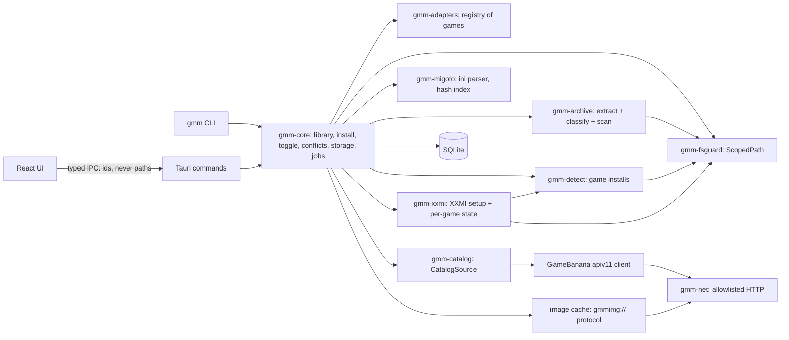

# 02 — Architecture

## Stack

| Layer | Choice | Why |
|---|---|---|
| Shell | Tauri 2 | Small native app; WebView2 on Windows, WebKitGTK on Linux; capability-based IPC; NSIS/MSI installers |
| Core logic | Rust workspace | All file, archive, network and process work lives here |
| UI | React + TypeScript + Vite, Tailwind + shadcn/ui, TanStack Query/Virtual, Zustand, Embla (carousel) | Widely used, well documented |
| Local DB | SQLite via `sqlx`, migrations in repo | One file in the app data dir |
| Archives | `zip`, `sevenz-rust2`, `unrar` (feature-gated), wrapped by our `gmm-archive` crate | All extraction goes through one hardened path |
| HTTP | `reqwest` (rustls), wrapped by our `gmm-net` crate | One place to enforce the host allowlist |
| Recycle Bin | `trash` crate | Deletes are recoverable |
| Tooling | pnpm, cargo workspace, `just` task runner | |

The **`gmm` CLI** is built from the same core crates. Every backend feature ships in the CLI first
(Phases 1–2). The UI (Phase 3) only presents what the CLI can already do.

## What GMM does and doesn't do

| GMM does | GMM doesn't |
|---|---|
| Browse/search GameBanana for supported games | Host, mirror or re-upload mods |
| Download, scan, extract into `<XXMI>/<IMP>/Mods/` | Inject DLLs or hook game processes |
| Enable/disable (XXMI's `DISABLED` prefix), detect conflicts, show storage | Edit game files or game settings (XXMI does that) |
| Detect games and XXMI setup state; guide the user | Install or update XXMI (link to its releases) |
| Start XXMI via its CLI (`--nogui --xxmi <IMP>`) | Run any executable that comes from a mod |

## Component map



## Repo layout

✅ = exists today; the rest is planned.

```
gacha-mod-manager/
├─ apps/desktop/              # Tauri app: src/ (React), src-tauri/ (thin command layer)   (Phase 1/3)
├─ crates/
│  ├─ gmm-fsguard/            # ✅ ScopedPath, RelPath, root registry, denylist
│  ├─ gmm-net/                # ✅ allowlisted HTTP, rate limiting, resumable verified downloads
│  ├─ gmm-archive/            # ✅ hardened zip/7z extraction, policy scan
│  ├─ gmm-catalog/            # ✅ CatalogSource trait, cache, GameBanana client
│  ├─ gmm-adapters/           # ✅ game manifests (games/*.toml), schema, validation, registry
│  ├─ gmm-detect/             # ✅ Steam / HoYoPlay / Epic / manual detection, VDF parser,
│  │                          #    the only registry reads (env.rs)
│  ├─ gmm-xxmi/               # ✅ XXMI root + allowlisted config read, importer checks, setup states
│  ├─ gmm-db/                 # ✅ SQLite + migrations: settings, installed mods, caches
│  ├─ gmm-cli/                # ✅ `gmm` binary
│  ├─ gmm-core/               # ✅ install pipeline, library (list, toggle, uninstall),
│  │                          #    conflicts, app folders; storage comes next (Phase 2)
│  └─ gmm-migoto/             # ✅ 3DMigoto .ini parser: overrides, hashes, namespaces, keybinds
├─ packages/ui/               # shared React components                                      (Phase 3)
├─ docs/                      # these docs (docs/research/ is local only)
├─ CLAUDE.md                  # working agreements (doc updates per phase, commits, code rules)
├─ LICENSE-MIT, LICENSE-APACHE, README.md, CONTRIBUTING.md
└─ deny.toml, clippy.toml, rust-toolchain.toml, rustfmt.toml, justfile
```

Test fixtures live next to each crate (`crates/*/tests/`), built in code at test time (fake
Steam libraries, fake XXMI roots, malicious archives) so the repo holds no binary blobs or real
user data.

## Core concepts

- **Game**: a compiled-in adapter (`zzz`, `wuwa`), mapped to one XXMI importer (`ZZMI`, `WWMI`).
- **Game install** (`gmm_detect::GameInstall`): a detected copy of the game. Fields: game id,
  source (Steam / HoYoPlay / Epic / manual), canonical game folder (read-only to GMM), and
  Steam appid if any.
- **Setup state** (`gmm_xxmi::GameStatus`): per game, one of `XxmiNotFound`,
  `ImporterMissing`, `ImporterBroken`, `GamePathNotSet`, `PathMismatch`,
  `LaunchModeMismatch`, `Ready`, with a summary, fix steps, notes, versions and mod counts
  (see [03](03-game-adapters.md)). Computed fresh each time; nothing is stored.
- **Catalog entry**: cached GameBanana mod metadata and file list.
- **Installed mod**: a folder under `<XXMI>/<IMP>/Mods/GMM/` with a `gmm.json` sidecar
  (`gmm_core::Sidecar`: format, game, name, variant, GB mod id, file id, file name, file date,
  version, SHA-256 of the archive, install time, GMM version) and a row in `installed_mods`.
  3DMigoto only loads `.ini` files, so the sidecar is ignored by XXMI.
- **Unmanaged mod**: any other folder in `Mods/`. GMM shows it, includes it in conflicts and
  storage, and offers "adopt" (link to a GB entry). It never moves or deletes one without an
  explicit user action.
- **Download cache**: original archives in `%LOCALAPPDATA%\GMM\cache\downloads`, kept for quick
  reinstall/rollback. Size-capped and clearable from the Storage screen.

## Install & toggle model

GMM installs **directly into XXMI's folder**, under its own subfolder. XXMI's `d3dx.ini` already
has `include_recursive = Mods`, so nested folders load:

```
<XXMI>/ZZMI/Mods/
  GMM/
    Ellen - Maid Outfit [gb-652373]/        ← enabled
      gmm.json
      Ellen.ini, *.buf, *.ib, *.dds ...
    DISABLED Miyabi - Casual [gb-610001]/   ← disabled (XXMI: exclude_recursive = DISABLED*)
  SomeHandInstalledMod/                     ← unmanaged, left alone
```

- **Enable/disable** = rename with or without the `DISABLED ` prefix. This is XXMI's own
  convention, so the state also makes sense to someone browsing the folder or using XXMI's tools.
- **Variants** (several full mods in one archive): each chosen variant becomes its own folder
  (`… [gb-id] (Variant B)`), so they toggle independently. The conflict checker usually flags
  enabling two variants of the same mod.
- **Writes are atomic per mod:** the archive is extracted under the cache
  (`%LOCALAPPDATA%GMMchextract<id>`), the chosen variant's files (minus blocked ones)
  are copied to `Mods/GMM/DISABLED .staging/<id>/<n>/` with their `gmm.json`, the DB row is
  written, and the folder is renamed into place (the row is removed again if the rename
  fails). Staging lives under `Mods/`, so the rename stays on one volume, and its `DISABLED`
  prefix means 3DMigoto skips it for certain (`exclude_recursive = DISABLED*`), without
  waiting on the in-game `.staging` check. Staging and extraction folders older than an hour
  are leftovers from a crash and are removed the next time GMM runs.
- **Folder names** are `<name> [gb-<id>]` plus ` (<variant>)` for one of several variants.
  GameBanana names are untrusted: characters Windows forbids become spaces, a leading
  `DISABLED` or `.` is dropped, the name is capped at 80 characters and validated like any path
  component. GMM never overwrites: a name already in the DB, or an existing folder (enabled or
  `DISABLED`) GMM didn't install, stops the install.
- **Uninstall** = move the mod folder to the Recycle Bin (`Guard::move_to_trash`, `trash`
  crate) and remove the DB row. The archive stays in the download cache.
- **The disk is the truth for on/off.** `gmm list` compares each DB row with `Mods/GMM/`:
  a folder renamed by hand updates the row; a folder that's gone is shown as missing (and
  uninstalling it only removes the record); both names present is refused as ambiguous.
- **Folder names must stay stable (observed 2026-10-23).** 3DMigoto saves each mod's in-game
  toggle state in `<IMP>/d3dx_user.ini`, keyed by the mod's **path**, e.g.
  `$\mods\phoenix\resources\phoenix.ini\headband = 0`. Renaming or moving a mod folder,
  including adding the `DISABLED` prefix, orphans those keys, and 3DMigoto drops orphaned keys
  the next time it saves. So GMM picks a mod's folder name once at install and never renames
  it except to toggle it. Profiles snapshot `d3dx_user.ini` (Phase 4) so toggle choices
  survive a disable/enable cycle.

## Conflict detection

Implemented: `crates/gmm-migoto` (parser) and `gmm-core::conflicts` (`gmm conflicts`, the check in
`gmm enable`, and the warning after `gmm install`).

3DMigoto mods conflict when two enabled mods override the same resource. `gmm-migoto` parses every
`.ini` in each enabled mod (managed or not; files and folders named `DISABLED*` are skipped, as
3DMigoto does) and keeps:

- `[TextureOverride*]` / `[ShaderOverride*]` sections with a `hash` (lowercased), their
  `match_first_index`, and whether they replace geometry (`ib`, `vb<n>`, `handling`,
  `override_vertex_count`, `override_byte_stride`, `draw*`) or textures (`ps-t<n>`, `vs-t<n>`
  and the other stages' texture slots). Sections that only watch a hash (set a variable, run a
  command list) replace nothing and never conflict
- the top-level `namespace` declaration
- `[Key*]` sections (`key`, `back`, `type`; for the keybind viewer later)

The parser never fails (junk lines are skipped, input is capped at 4 MiB) and is
property-tested for panics. `if`/`elif`/`endif` are ignored: a key counts wherever it appears in
its section. Two overrides overlap when the hash matches and either has no
`match_first_index` or both have the same one (ZZZ mods often split one buffer into parts).

Severity:

| Level | Rule | UI |
|---|---|---|
| **Conflict** | Two enabled mods override the same hash with geometry/texture replacement | CLI: `gmm enable` refuses unless `--anyway`; `gmm install` warns (the new mod stays on). UI: blocking dialog on enable: "Disable X and enable Y" / "Enable anyway" / "Cancel" |
| **Warning** | Same GameBanana character (subcategory), but no shared hashes | Badge only. ⏳ Not built yet: needs the mod's category stored at install |
| **Ignored** | Shared library mods: ZZMI ships SlotFix, TTLib, HP bar under `Core/`, which is outside `Mods/` and never read; Mods-folder libraries are matched by `namespace` against the manifest's `[conflicts] ignore_namespaces` (empty for ZZZ and WuWa so far) | Listed as "library (ignored)" |

The index is rebuilt on every check (fast enough for the CLI; caching it in SQLite keyed by mod
folder + mtime is a later optimisation). Conflicts are advisory: GMM never edits a mod's ini.

## Storage accounting

Implemented in `gmm-core::storage` (`gmm storage`). For each game: every managed and unmanaged
mod's size (largest first), the totals, other files (loose non-mod files in `Mods/` and staging
leftovers), and free space on the drive. For the cache: downloads (with partial downloads),
leftover extraction folders, and the GameBanana responses in the database. Sizes are measured on
disk each time without following links (a walk stops at 500,000 entries and reports "at
least"); a managed mod's recorded size is corrected when it changed. Free space comes from
`Guard::available_space` (`fs4`). `gmm storage --clear-downloads` moves every cached archive to
the Recycle Bin and drops the records; installed mods stay. Planned for the Storage screen
([07](07-frontend-design.md)): multi-select disable, delete (Recycle Bin), or clear one mod's
cached archive.

## Catalog flow (GameBanana apiv11)

Game ids: ZZZ = 19567, WuWa = 20357. All endpoints below were verified against the live API
on 2026-10-22 and are implemented in `crates/gmm-catalog`:

| Purpose | Endpoint |
|---|---|
| Root categories | `GET /apiv11/Mod/Categories?_idGameRow={gameId}&_sSort=a_to_z&_bShowEmpty=true` |
| Subcategories (characters) | `GET /apiv11/Mod/Categories?_idCategoryRow={categoryId}&_sSort=a_to_z&_bShowEmpty=true` |
| Browse | `GET /apiv11/Mod/Index?_nPage=N&_nPerpage=N&_aFilters[Generic_Game]={gameId}` + optional `_aFilters[Generic_Category]={id}` and `_sSort=` one of `Generic_Newest`, `Generic_LatestUpdated` (only updated mods), `Generic_MostDownloaded`, `Generic_MostLiked`, `Generic_MostViewed`. Unknown sorts → HTTP 400 `INPUT_ERRORS` |
| Search | `GET /apiv11/Util/Search/Results?_sModelName=Mod&_sOrder=best_match&_idGameRow={gameId}&_sSearchString=…&_nPage=N` (fixed 15 per page) |
| Mod page | `GET /apiv11/Mod/{id}/ProfilePage` (404 `NO_SUCH_RECORD` if missing) |
| Files | `GET /apiv11/Mod/{id}/DownloadPage` |
| Updates/changelog | `GET /apiv11/Mod/{id}/Updates?_nPage=N&_nPerpage=N` (`_aChangeLog[]` of `{text, cat}`) |

Downloads: `_sDownloadUrl` (`https://gamebanana.com/dl/<fileId>`) redirects to
`files.gamebanana.com`, then to a numbered mirror such as `filecache42.gamebanana.com`. Range
requests work (HTTP 206), so downloads can be paused and resumed. Images live on
`images.gamebanana.com`, as `_sBaseUrl` + `_sFile` (original) or `_sFile100/220/530/800`
(scaled, with `_wFile*`/`_hFile*` sizes).

GameBanana's JSON is loosely typed (numbers as strings, `[]` for empty objects), so the client
decodes every field leniently.

Rules: HTTP cache (SQLite `http_cache` table in `gmm-db`) with lists cached for
minutes and detail pages for an hour; a global rate limit of about 2 requests/second with
backoff on 429/5xx; and an identifying `User-Agent`. GameBanana sends no rate-limit headers. Store each mod's
license, never re-host files, respect `_sInitialVisibility` / content ratings (NSFW hidden by
default), and sanitize `_sText` HTML before display. The full mod page field mapping is in
[07](07-frontend-design.md).

**Images** go through a Rust-side cache served to the webview via a custom protocol
(`gmmimg://<hash>`). The webview never contacts the internet. Images are cached on disk with a
size cap, and nothing that identifies the user is sent to image hosts.

## Install flow

Implemented in `crates/gmm-core` (`gmm install`). Steps marked ⏳ come with later features.

```
setup gate: XXMI and the importer must exist (else refuse); any other non-Ready state warns
mod page ─► refuse trashed / withheld / obsolete mods, and mods whose _aGame isn't this game
pick GB file (newest clean one, or --file) ─► _sAvResult must be "clean"
            ─► download into cache/downloads (allowlisted host after every redirect, exact
               _nFilesize, MD5 if given), or reuse the cached copy; record SHA-256 in download_cache
            ─► extract to cache/extract/<id> (all hardening rules) ─► policy scan
            ─► classify: a folder is a mod root when it directly holds an .ini with one of the
               manifest's markers ([TextureOverride / [ShaderOverride, case-insensitive) and no
               folder above it does. DISABLED* names and d3dx.ini don't count
            ─► one root = one mod; several = variants: --variant N|name (repeatable) or
               --all-variants, otherwise the install stops and lists them
            ─► blocked files inside the chosen mod stop the install (--skip-blocked leaves
               them out); blocked files elsewhere in the archive don't matter
            ─► ⏳ conflict check against enabled mods
            ─► copy to Mods/GMM/DISABLED .staging/<id>/ ─► gmm.json ─► DB row ─► rename into
               Mods/GMM/<folder> ─► remove extraction + staging folders
```

## Launch flow

GMM shows the game's XXMI state on its page. When it's `Ready`, **Launch with XXMI** runs
`<XXMI>/Resources/Bin/XXMI Launcher.exe --nogui --xxmi <IMP>`. That's XXMI's own command line:
its "Add Desktop Shortcut" creates `<IMP> Quick Start.lnk` with exactly these arguments
(observed). `gmm status` already prints this command for ready games; `gmm launch` (Phase 2)
will run it after the user confirms the exe once. XXMI then starts the game (through Steam if
its Game Launch says so) and injects. GMM doesn't watch or touch the game process.

The game page always shows this notice:

> Mods only load when the game is started through XXMI. Launching from Steam or the game's own
> launcher alone starts the game without mods. Sorry, we know it's an extra step. Use
> **Launch with XXMI** here, or XXMI's own Quick Start shortcut.

For Steam copies, XXMI's **Game Launch = Steam** makes XXMI start the game through Steam itself,
so users don't need to start XXMI first and the game second. The setup check enforces the
matching Game Launch setting (`LaunchModeMismatch`).

## Data model (SQLite)

`crates/gmm-db`, one file at `%APPDATA%\GMM\gmm.db`. The schema is in
`crates/gmm-db/migrations/` and is applied when the database opens; an older GMM refuses a
database that a newer one has migrated. sqlx 0.9 with SQLite bundled, WAL journal, foreign
keys on, every query a static SQL string with bound parameters (sqlx rejects anything else).
Times are Unix seconds. Built so far (migration 0001):

```
settings(key PK, value)                  -- xxmi.root (a folder the user picked),
                                         -- xxmi.confirmed_exe (R7); typed accessors only
manual_game_folders(game_id, folder, added_at, PK(game_id, folder))
installed_mods(id PK, game_id, folder_name, name, gb_mod_id NULL, gb_file_id NULL,
               variant NULL, version NULL, file_date NULL, enabled BOOL, archive_sha256 NULL,
               size_bytes, installed_at, scan_report_json NULL, UNIQUE(game_id, folder_name))
download_cache(sha256 PK, gb_mod_id NULL, gb_file_id NULL, path_rel UNIQUE, size_bytes,
               added_at, last_used_at)
http_cache(url PK, body, fetched_at)     -- each endpoint passes its own max age on read;
                                         -- rows older than 7 days, or beyond 5,000, are
                                         -- pruned on open
```

- `installed_mods.folder_name` never includes the `DISABLED ` prefix; `enabled` says which
  name is on disk. Only managed mods are stored. Unmanaged mods are listed from disk each
  time, so GMM never has a stale idea of what someone put there by hand.
- Setup states, detected installs and XXMI roots are **not** stored: they're cheap to work
  out and must reflect the machine as it is now. Only what the user told GMM (manual folders,
  a picked XXMI folder, the confirmed exe) is remembered.
- The database never holds anything from XXMI's config file (R4).

Planned with later features: `ini_index(mod folder, mtime, hashes_json, namespaces_json,
keys_json)` with `gmm-migoto`; parsed `catalog_mods`/`catalog_files` rows only if the UI needs
queries the raw response cache can't answer.

## App directories (Windows)

| Purpose | Path |
|---|---|
| Config + DB | `%APPDATA%\GMM\` |
| Caches (downloads, images, HTTP) | `%LOCALAPPDATA%\GMM\cache\` |
| Logs (local only, home path redacted) | `%LOCALAPPDATA%\GMM\logs\` |

On Linux these map to the XDG equivalents through Tauri's path API.
